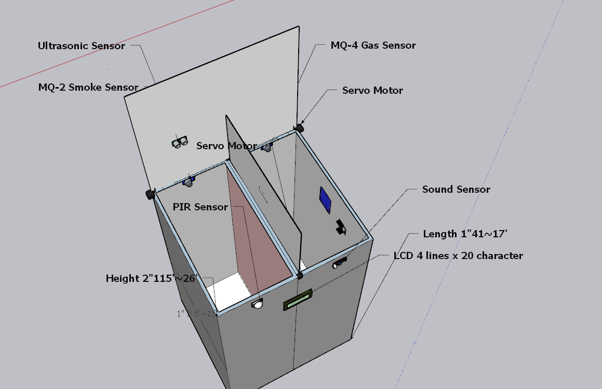
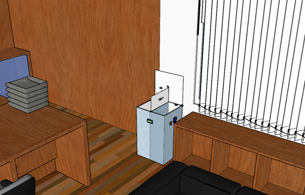
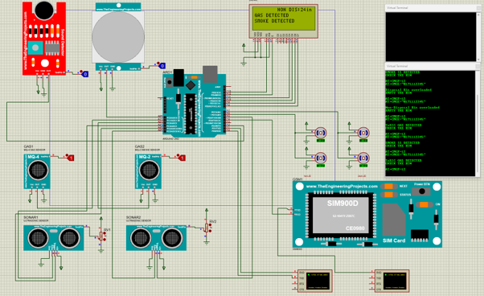
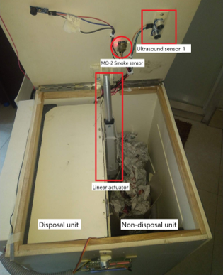
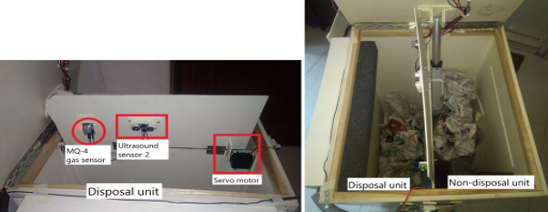
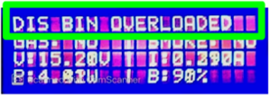
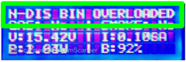
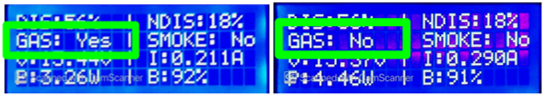
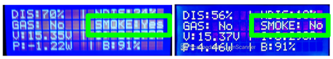
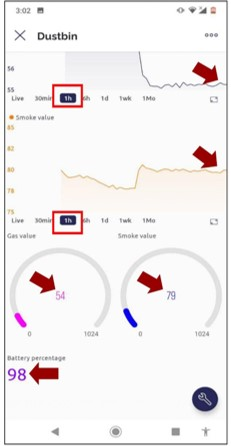

# Design and Implementation of Smart Waste Bin for Office Spaces

Waste management is often treated as a simple problem: put a bin in a room and empty it regularly. In reality, conventional waste bins provide very little information about their condition. They can overflow, require physical contact, mix different types of waste, and need manual checking to determine when collection is required. The solution was to design and development of a dual-compartment smart waste bin for office environments.

## Project Overview

This project focused on designing and building a touchless smart waste bin for office environments. The prototype uses two separate compartments for disposable and non-disposable waste, automated lid operation, waste-level monitoring, gas and smoke detection, and IoT connectivity. The initial design targeted a 17 × 15 × 26 inch structure, with waste-level sensing, weight detection up to 50 kg and an electronic control and communication system.

## Key Features

- Touchless lid operation using sensors and actuators
- Separate compartments for disposable and non-disposable waste
- Ultrasonic waste-level detection
- Gas and smoke monitoring
- Real-time status displayed on a 20×4 LCD
- Remote monitoring through ESP32 and Blynk

## Hardware 

- Arduino Uno
- ESP32
- Ultrasonic sensors
- MQ-series gas and smoke sensors
- Servo motor and linear actuator
- 20×4 LCD

## Software
- Sketchup
- Arduino IDE
- Proteus
- Blynk IoT Platform

## Source Code

The project includes two embedded programming files:

- [Arduino Controller Code](code/ARDUINO_CODE.ino) — Arduino-based control program for the Smart Waste Bin.
- [ESP Code](code/ESP_CODE.ino) — ESP-side program used in the project's IoT implementation.

## Project Development

The project involved circuit design, embedded programming, sensor integration, physical prototyping and functional testing. During development, the team compared Proteus, Tinkercad and Autodesk EAGLE. We selected Proteus because it supported the Arduino-based design and provided access to many of the sensors and electronic components required for the project. It also allowed the circuit design to be tested together with embedded code before moving to physical implementation.

## System Operation

The smart waste bin uses an Arduino Uno as its main controller to process sensor inputs and operate the lid mechanisms.An ultrasonic sensor detects a person approaching the bin and triggers the touchless main lid mechanism. Additional ultrasonic sensors monitor waste levels in the two compartments. MQ-4 and MQ-2 sensors monitor gas and smoke conditions. A 20×4 LCD displays local system information, while an ESP32 provides connectivity to the Blynk IoT platform for remote monitoring. The prototype combines embedded programming, sensor interfacing, actuator control, power distribution and IoT communication in one system.

The final implementation included several different components working together:
HC-SR04 ultrasonic sensors for waste-level and user-presence detection
MQ-4 gas sensor for the disposal compartment
MQ-2 smoke sensor for the non-disposal compartment
MG995 servo motor for lid operation
12 V linear actuator for the main lid
20 × 4 LCD for local status information
ESP32 for IoT connectivity
Blynk for displaying sensor information through a mobile application/web interface
DC-DC buck converters, relay circuitry and a fuse for power distribution and protection

The system was powered using four 3.7 V, 1500 mAh Li-ion batteries, with different DC-DC converter outputs supplying the required voltage levels to individual components. 

The ultrasonic sensor mounted at the front was used to detect a user. In the implemented logic described in the report, when a person remained in front of the sensor for approximately five seconds, the main lid would open. The disposal section included methane detection, while smoke detection was incorporated into the non-disposal section. The proposed control logic also included alerts when abnormal conditions were detected.

### LCD Monitoring Results

### IoT Monitoring Results
An ESP32 was incorporated to provide connectivity between the physical system and the Blynk IoT platform.
Sensor readings and device status could therefore be visualised through a mobile application and website rather than requiring someone to inspect the bin manually.
This creates a basic IoT architecture:
Sensors → Arduino → ESP32 → Blynk → User
Instead of checking every bin manually, information about the bin's condition can be made available remotely.

## Project Team

- Md Fuad Fahimul Haque
- Seeam Monon
- Tasnia Rahman
- Md Naimur Rashid

