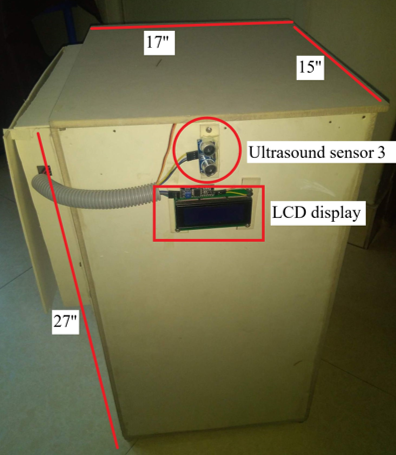
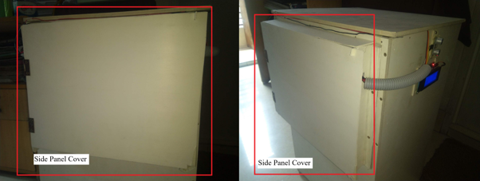
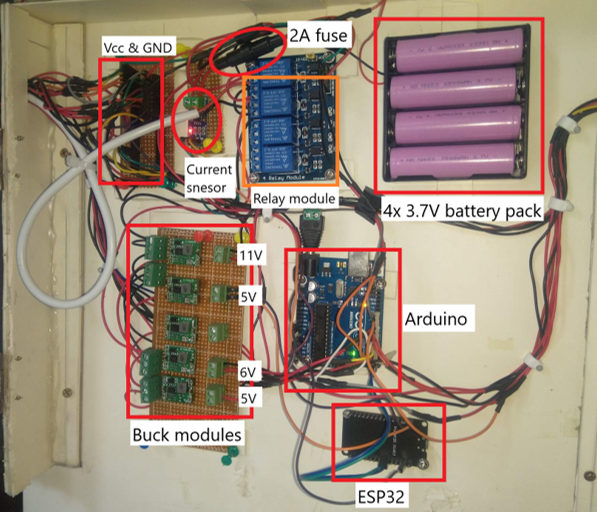
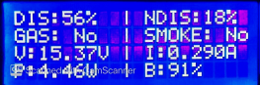
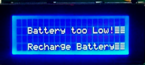
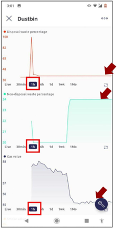
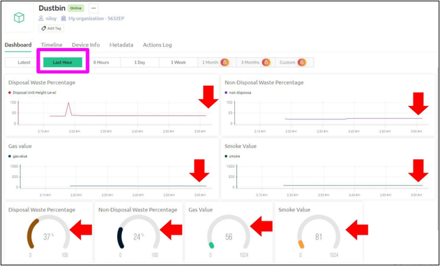
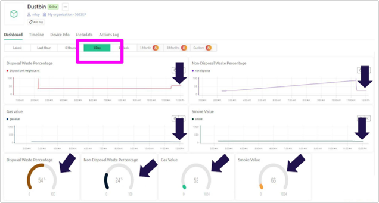

# Design and Implementation of Smart Waste Bin for Office Spaces

An Arduino-based smart waste management prototype developed as a Final Year Design Project at BRAC University in 2023.

## Project Overview

This project focused on designing and building a touchless smart waste bin for office environments. The prototype uses two separate compartments for disposable and non-disposable waste, automated lid operation, waste-level monitoring, gas and smoke detection, and IoT connectivity.

## Key Features

- Touchless lid operation using sensors and actuators
- Separate compartments for disposable and non-disposable waste
- Ultrasonic waste-level detection
- Gas and smoke monitoring
- Real-time status displayed on a 20×4 LCD
- Remote monitoring through ESP32 and Blynk

## Hardware and Software

- Arduino Uno
- ESP32
- Ultrasonic sensors
- MQ-series gas and smoke sensors
- Servo motor and linear actuator
- 20×4 LCD
- Arduino IDE
- Proteus
- Blynk IoT Platform

## Project Development

The project involved circuit design, embedded programming, sensor integration, physical prototyping and functional testing. During development, the team revised the lid mechanism and communication system to address practical implementation challenges.

## Project Team

- Md Fuad Fahimul Haque
- Seeam Monon
- Tasnia Rahman
- Md Naimur Rashid

## Institution

BRAC University — Department of Electrical and Electronic Engineering

Final Year Design Project | 2023

## Project Images

### Smart Waste Bin Prototype

### LCD Monitoring Results

### IoT Monitoring Results

